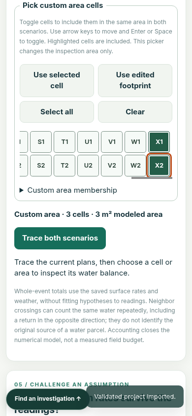

# Custom water-budget area receiving

[Issue #399](https://github.com/Jacob-Met/experimental-earth/issues/399) lets a person inspect the same chosen cells in both saved plans and retain that area through ordinary project export and reopening.

## Qualified behavior

The dedicated picker supports disconnected cells, native arrow/Enter/Space navigation, explicit pressed state, an empty-area state and shortcuts. Selection leaves terrain and the physical calculation unchanged. Saved dimensions and membership are validated at project entry points. Existing cell, edited-footprint and whole-site views and neighbor navigation remain available.

The actual application reproduces an independently calculated two-cell control: **42 L existing → 12 L proposed**, a **30 L reduction**. Changing rain from 30 to 35 mm/h clears the stale result and recomputes **52 → 22 L**. These are authored model controls.

## Verification

- Source base: `4ee5b97f829016ad841afd39206057fbe4f3782a`; exact changed-file Git blob and SHA-256 hashes are in [receiving.json](receiving.json).
- Node v22.23.4: **1,305/1,305 tests pass across 180 files**, using `node --test --test-concurrency=1 tests/*.test.mjs`.
- Chrome 156.0.8078.47: **15 focused browser checks pass**, including ordinary visible investigation navigation, actual native keyboard selection, active-brush isolation, ordinary Export Blob and Import/reload, the delayed-import revision guard, neighbor scope retention, stale rainfall and 390px/24-column containment. No browser runtime exceptions were observed.
- The maintained browser harness admitted the browser after its Linux namespace and Seccomp sandbox checks, and recorded direct-child cleanup. Run with `CHROME_BIN=/path/to/chrome node tests/custom-water-budget.browser.mjs`; supply a fresh unique `BROWSER_RUN_DIRECTORY` if overriding the default.
- Independent source review covered the validator, integration, reducer reuse, picker, portability, terrain/raster imports and receiving cases. The unit test's barrier provenance fixture was corrected before the passing run.

The runtime source was reconstructed through Renpō from exact Git blobs. Historical receipt screenshots were not needed to run the application; 123 such prior files were omitted. The first full unit run exposed missing Git metadata required by an existing CLI provenance check. A real local verification repository was initialized, and the complete suite then passed. No application change was made for that environment correction.

## Visible result

The lead inspected the 390px computed-area view and the wide picker. Selected cells and keyboard focus are distinct; controls wrap, and wide grids scroll inside the picker without widening the page.

The screenshot comes from the first passing focused run. Application files were unchanged for the final receiving run; only its navigation/diagnostic test helper was strengthened.

## Full browser-course limit

The broad `tests/browser.receiving.mjs` run stopped before this feature at an old assertion that Tab must move directly from `find-infiltration-reading` to `compare-resolution`. A matched sandboxed baseline/candidate probe established that **both** instead reach the legitimate “Plan complementary depth readings” summary. The receiver predates that intermediate control. An untouched broad baseline run also stopped earlier on a timing-sensitive imported-row assertion. A full broad-browser pass is therefore **not** claimed here; the complete unit suite and focused application receiving are the qualification evidence for this increment. Repairing that stale traversal assertion is a concrete follow-on.

## Scope of the evidence

The result qualifies software behavior, numerical accounting and source integration. It does not establish physical field validity, a deployed service, or a submitted contest entry. Operation IDs, source hashes, runtime paths and exact check descriptions are retained in [receiving.json](receiving.json).
