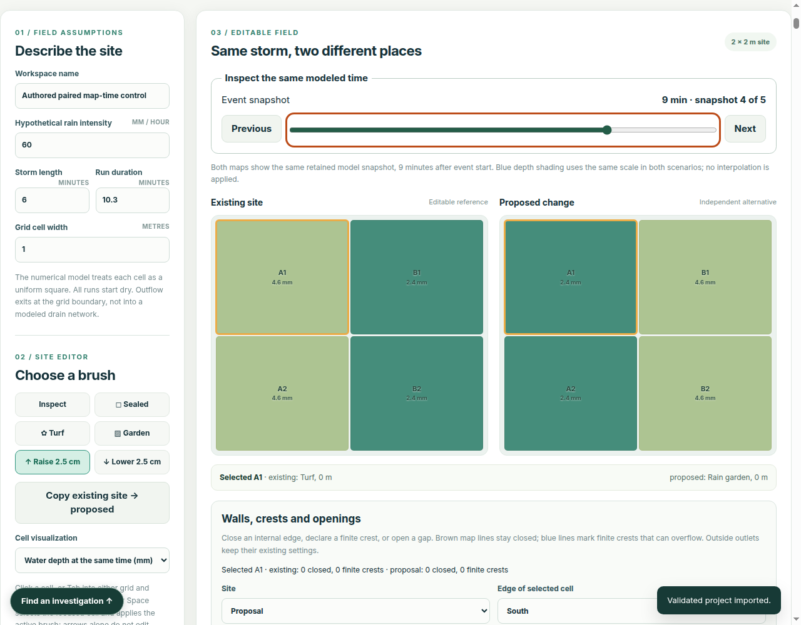
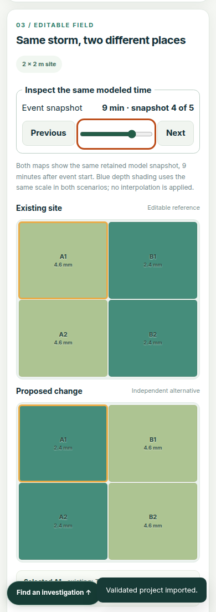

# Paired rain-map time: delivered consumer evidence

Issue: [#405](https://github.com/Jacob-Met/experimental-earth/issues/405)  
Source base: `fe22a7752cfb4049097aac05a375db1d141ccd68`  
Date: 2026-10-26

## Result

The ordinary rain maps now expose the same retained modeled time in both scenarios. Native snapshot controls reach minute zero, intermediate states and a fractional final step without interpolation. Time navigation redraws the maps, preserving the project, unfinished entries and the current model comparison.

The complete candidate passed **1,305/1,305 native tests** and **105 full-browser checks with 48 completed reloads**. The full browser recorded no runtime exceptions and passed the unchanged Chromium sandbox admission. Independent internal review approved the exact nine source/test/guide files after these conditions were met.

| Course | Source and result | Elapsed time |
| --- | --- | ---: |
| Matched focused baseline | Original app lacks snapshot mode/range; precise missing-capability failure retained | 4.32 s |
| Matched focused candidate | **8 checks passed**, 1 completed reload, no runtime exceptions | 5.03 s |
| Final native suite | **1,305 passed**, 0 failed, 180 test files | 17.83 s |
| Complete maintained browser | **105 checks passed**, 48 completed reloads, no runtime exceptions | 73.73 s |

These times describe these executions; the courses do different work and do not establish a performance improvement. [receiving.json](receiving.json) contains exact source digests, check descriptions, independent control values, layout measurements and the retained failure history.

## Consumer control

The authored 2×2 source alternates turf and garden, then reverses the surfaces in the proposal. With zero routing and boundary outflow, the two sites have **identical whole-site water curves but opposite local changes**. At minute 9, the turf/garden depths are independently 4.65/2.4 mm; the two maps must show those values at the correct reversed cells. The ordinary map rounds labels to its existing display precision while the receiver also verifies the exact retained numeric values.

Receiving checks native Home/End/arrows and endpoint-button activation; drydown distinct from peak/final; the fractional 10.3-minute endpoint; duration and imported-step changes; and the earlier snapshot on an exact nearest-time tie.

A real completed infiltration comparison serves as the invalidation control. Moving time/view leaves that comparison, notebook/metric/chart nodes, draft fields and exact saved bytes intact, with **zero storage writes**. A subsequent native brush edit does change the intended cell and invalidate the comparison, proving that the control responds to actual source changes.

## Actual rendered output

Both captures are from the passing focused course at minute 9. The lead inspected them at their actual dimensions.

### Desktop, 1280 px

### Narrow viewport, 390 px

## Earlier failures retained

The first native run passed 1,302/1,305. Two existing fixture checks could not locate the renderer because they assumed its old two-argument signature; a third required a single exact accessibility-description ID, rejecting an additional valid description. The harness now extracts the actual renderer up to the next top-level function, provides the ordinary grid dataset property and verifies IDREF token membership. All existing coordinate-oracle, tab-stop, focus, activation and no-paint assertions remain unchanged. The final complete run passed all 1,305.

The unchanged baseline browser failure is also retained. It reports the actual old selector modes `peak/final/surface` and absence of the range; it is not relabeled as a successful capability.

## Scope

No physical model, solver, interpolation or project schema changed. The time cursor is transient. This qualifies the exact candidate source and maintained local application experience. It does not establish deployment or field accuracy. See [the user guide](../../RAIN_MAP_TIME.md) for operation and interpretation.
